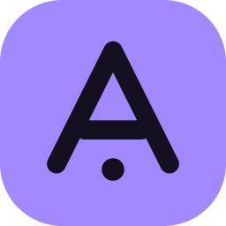
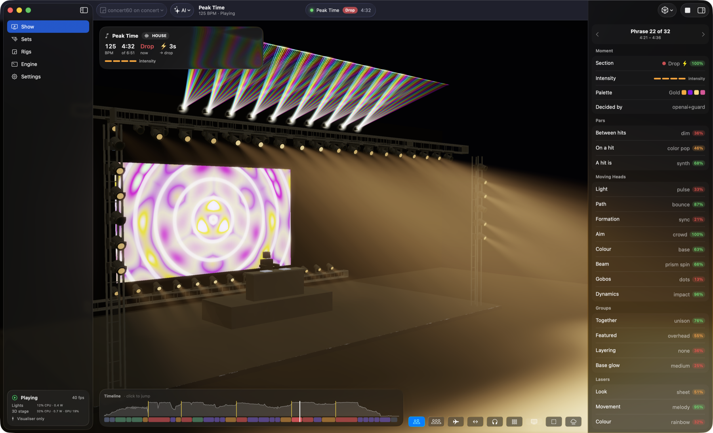
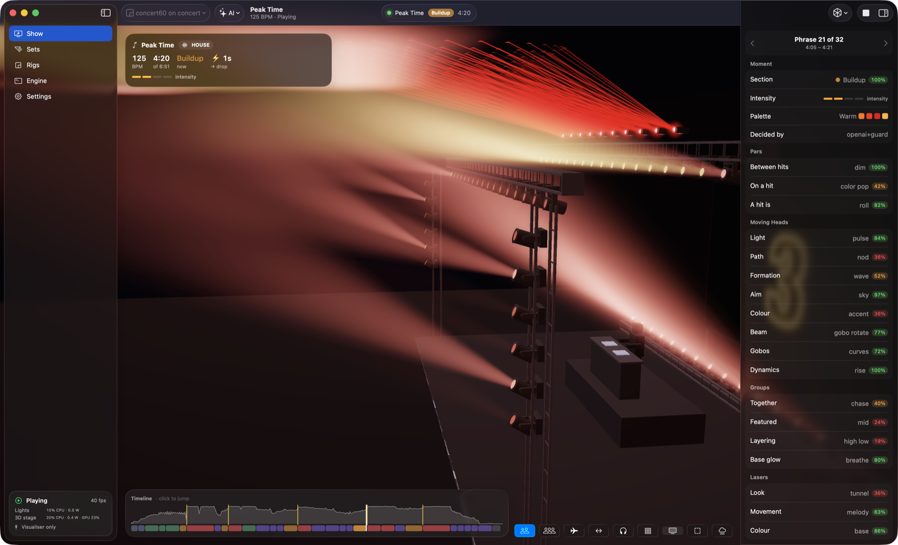
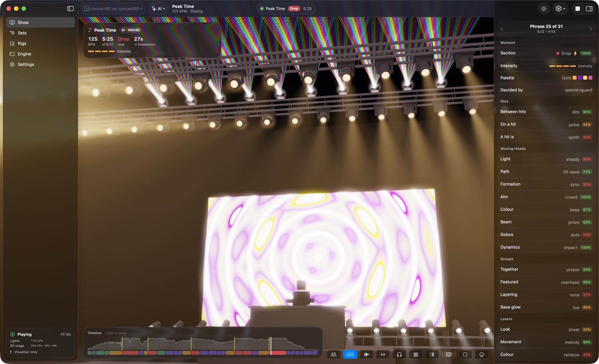
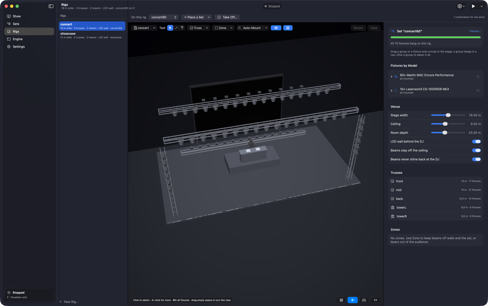

<!-- Translated from README.md at 3eed108. When README.md changes, bring this file along (Latin American Spanish,
     tú, trade words as the crew says them: set, rig, truss, fixture, DMX). The developer part stays in English. -->

# Amadeus DMX

[English](README.md) · **Español**

### Tu director de iluminación con IA, toda la noche.

Amadeus DMX escucha la música que pones y maneja tus luces como lo haría un diseñador de iluminación:
desde un warm-up tranquilo hasta los últimos temazos de la fiesta, exacto al beat, frase por frase.

&nbsp;

&nbsp;

  

El drop, en vivo en la app: 60 moving heads, 10 láseres y una pantalla LED que hizo la cuenta regresiva. A la derecha, lo que eligió el director IA para esta frase.

  

---

> [!NOTE]
> **La app de Windows habla español:** elige *Español (Latinoamérica)* en Configuración › General › Idioma, o
> deja que siga el idioma de Windows. La app de Mac y la documentación por ahora están en inglés.

> [!IMPORTANT]
> ### 🎛️ Buscamos beta testers
>
> **Necesitamos entusiastas con rigs reales que prueben nuestro software y nos den su opinión.** El escenario 3D
> muestra lo que Amadeus DMX *cree* que hacen tus luces. Solo fixtures reales, lugares reales y público real
> muestran lo que *de verdad* hacen.
>
> **Eres el tester indicado si tienes:**
> - **luces DMX reales**: moving heads, pars, barras, strobes, láseres, humo… cualquier marca, cualquier tamaño
>   de rig;
> - **una forma de enviar DMX**: un nodo Art-Net o sACN, o una interfaz USB DMX;
> - **una Mac con Apple Silicon o una PC con Windows** (los testers de Windows son especialmente bienvenidos:
>   es totalmente nueva);
> - idealmente **VirtualDJ, djay Pro o Mixxx**, y shows o ensayos donde probarlo: noches de club, bodas, fiestas,
>   noches latinas, bandas.
>
> **Lo que te pedimos:** configura tu rig en la app, corre un show (un ensayo en tu sala cuenta) y cuéntanos qué
> viste. Qué fixtures funcionaron de inmediato y cuáles no, si las luces caían en el beat, si la noche se sintió
> bien y qué te confundió en el camino. Un video corto con el celular dice más que una página de texto.
>
> **[Enviar un reporte beta →](https://github.com/mathijs-b2m/AmadeusDMX/issues/new?template=beta-report.yml)**
> &nbsp;·&nbsp; [Cómo funcionan los comentarios](#pruebas-beta-y-comentarios)

---

> **Una nota del creador**
>
> Creé Amadeus DMX porque es el software que siempre me faltó en mi carrera como DJ móvil. No hay nada parecido
> en el mercado (gratuito): un director de iluminación totalmente impulsado por IA que te acompaña toda la noche
> de un evento. Desde el arranque tranquilo hasta los últimos temazos, el show evoluciona con la noche y con la
> música.
>
> Configurar tus rigs y fixtures nunca fue tan fácil. ¿Y después? ¡Dale play!
>
> Ah, y: integraciones con **djay Pro**, **VirtualDJ** y **Mixxx**, e incluso **Spotify** como fuente de música.
> Para los usuarios avanzados: corre Amadeus DMX en una laptop de iluminación aparte. Y ahora en **Mac y
> Windows**.
>
> — Mathijs

---

## Por qué les encanta a los DJs

<table>
<tr>
<td width="50%" valign="top">
<h3>🧠 Un director IA para toda la noche</h3>

Decide el look de cada frase musical: qué luces tocan, los colores, cómo se mueven los moving heads. Usa OpenAI, un modelo local gratuito o el director basado en reglas, que funciona totalmente sin conexión.

</td>
<td width="50%" valign="top">
<h3>🌙 Una noche con historia</h3>

El <b>arco del show</b> sigue tu noche a partir de la música: un warm-up acogedor mientras se llena el lugar, la pista que se arma, los picos, los respiros, el final. La artillería pesada se queda guardada hasta los momentos que se la ganan. Una hora o diez, noche de club, boda, fiesta o noche latina, en el orden en que <i>tú</i> la toques.

</td>
</tr>
<tr>
<td valign="top">
<h3>⚡ Exacto al beat</h3>

Cada pista se analiza de antemano: beats, compases, frases, build-ups, drops, redobles de caja. El bombo manda, el drop cae con un corte seco y un flash, y los movimientos de los moving heads caen en el beat, porque salen de la música misma, no de una suposición.

</td>
<td valign="top">
<h3>🎶 Escucha la música, no solo el beat</h3>

Cada género tiene su propio estilo: techno en hielo y fuego, el boom-tac del reggaetón, la cumbia bailando en el beat y en su "y" con todos los colores de la fiesta, una bola de espejos para el disco, el hardstyle martillando sus clímax y aislando un twister de beams en el break, los colores rave y los breaks de piano del happy hardcore, el rock iluminado como una batería con los rasgueos de la guitarra, las bandas sonoras tocadas golpe a golpe como una orquesta. Las canciones pop tienen estrofas y coros, no drops falsos de EDM.

</td>
</tr>
<tr>
<td valign="top">
<h3>🛠️ Listo en minutos</h3>

Un asistente te guía por tus fixtures, el lugar y dónde se cuelga cada cosa. Arrastra fixtures a trusses rectos o circulares en el editor de rigs 3D, o deja que los cuelgue por ti. Incluye unos <b>3,000 fixtures de 270 marcas</b>, sin conexión, y se puede importar el archivo GDTF del fabricante. ¿Algo poco común? Mapea sus canales a mano con el <b>mapeador DMX</b>, probándolos en la luz real.

</td>
<td valign="top">
<h3>📋 De la app al truss</h3>

¿Lo diseñaste en la app? Imprime una <b>hoja de colgado</b> para el equipo: un plano visto desde arriba, dónde va cada fixture, su dirección DMX y etiquetas para los cases. Después de colgar, la <b>revisión</b> los enciende uno por uno, y un fixture cambiado de lugar o girado se corrige en la app con un clic.

</td>
</tr>
<tr>
<td valign="top">
<h3>🎧 Toca junto con tu software de DJ</h3>

Sigue tu mezcla en vivo en <b>VirtualDJ</b>, <b>djay Pro</b> y <b>Mixxx</b>: qué deck suena, los crossfades, los drops. Hasta las pistas de <b>Spotify</b> en djay Pro y VirtualDJ pueden iluminarse (si lo activas). Una pista cargada en el último segundo toca un groove a su tempo hasta que su propio show esté listo.

</td>
<td valign="top">
<h3>💻 Una laptop de iluminación, si quieres</h3>

Deja tu laptop de DJ para la música. <b>Amadeus Link</b> en la laptop de DJ se empareja con la computadora de iluminación con un código de 4 dígitos, y el show sigue tu mezcla por la red. Mac y Windows, en cualquier combinación.

</td>
</tr>
<tr>
<td valign="top">
<h3>🎛️ Perillas en vivo</h3>

Toma el control en cualquier momento: cuántas luces tocan, efectos especiales, la pantalla LED, el humo, el movimiento, la variedad de colores, el tamaño del drop, los flashes, la intensidad. Suelta una perilla y el arco del show vuelve a tomar el mando. Las máquinas de humo también se tocan, a la medida de la máquina y del lugar.

</td>
<td valign="top">
<h3>🛡️ Seguro desde el inicio</h3>

Los flashes tienen un tope de 4 Hz, los moving heads solo hacen strobe sobre la cuadrícula del beat, y las zonas de láser, las zonas prohibidas y las reglas de seguridad ocular mantienen los beams donde deben estar. Mientras configuras, un limitador de brillo pone un tope a cada luz (y te avisa que está activo).

</td>
</tr>
<tr>
<td valign="top">
<h3>📄 A partir de los documentos del lugar</h3>

¿Tocas en un lugar con su propio rig de la casa? <b>Importar desde documentos</b> arma el set y el rig con lo que manda el lugar: una escena MVR, hojas de patch (CSV, Excel) o los PDF del rider y los planos de luces, leídos con IA usando tu propia clave de OpenAI. Los planos quedan debajo del rig en el editor, alineados con dos clics, y el reporte dice qué revisar.

</td>
<td valign="top">
<h3>🤖 Tu propio asistente de IA</h3>

Deja que <b>Claude</b> o <b>Codex</b> configuren tu equipo: describe tu rig o tu lugar y arman los rigs, agregan y montan los fixtures y revisan el resultado, con deshacer. ¿Un fixture que no está en ninguna biblioteca? Lo construye a partir de la tabla DMX del manual del fabricante. Un interruptor en Configuración › Integraciones conecta Claude Desktop.

</td>
</tr>
</table>

**Míralo antes de montarlo:** un escenario 3D en vivo muestra cada beam, así que puedes planear y probar un show
sin una sola luz conectada, y volar por el lugar para verlo desde cualquier punto. Cuando estés listo, el mismo
show sale por Art-Net, sACN o una interfaz USB DMX.

<table>
<tr>
<td width="50%" valign="top">

El build-up: la pantalla LED cuenta hacia el drop

</td>
<td width="50%" valign="top">

El mismo drop desde la pista de baile

</td>
</tr>
<tr>
<td colspan="2" valign="top">

El editor de rigs: tu lugar, con cada fixture donde cuelga

</td>
</tr>
</table>

## Cómo empezar

> [!TIP]
> **Activa todo.** La **[guía de configuración para Mac](docs/mac-setup.md)** (en inglés) te lleva paso a paso
> con capturas: la clave de OpenAI del director IA, los modelos de análisis de instrumentos, iluminar pistas de
> Spotify, tu software de DJ, tu rig y tus luces. Quince minutos que hacen la diferencia.

1. **[Descarga Amadeus DMX](https://github.com/mathijs-b2m/AmadeusDMX/releases/latest)** de la última versión.
   - **Mac** (Apple Silicon, macOS 26 o posterior): abre la imagen de disco y arrastra la app a Aplicaciones.
     Está firmada y notarizada por Apple, así que se abre como cualquier otra app.
   - **Windows** (Windows 10 22H2 u 11, x64): ejecuta el instalador. Hasta que tengamos nuestro certificado de
     Windows, SmartScreen puede decir *Windows protegió su PC*: haz clic en *Más información* › *Ejecutar de
     todas formas*. Solo lo haces una vez.
2. **Activa los extras** en Configuración: tu clave de OpenAI para el director IA, los paquetes opcionales
   (análisis de instrumentos y pistas en streaming) e *Iluminar pistas en streaming*. Mira la
   [guía de configuración](docs/mac-setup.md).
3. **Sigue el asistente de configuración:** tus fixtures, tu lugar, listo. O importa los documentos del lugar
   (Rigs › Importar desde documentos…). ¿Todavía no tienes luces? Abre uno de los ejemplos (un showcase, un
   escenario de concierto con 60 heads, el Melkweg Max de Ámsterdam) y mira el escenario 3D.
4. **Dale play.** Reproduce una pista, o inicia un show en vivo y pincha como siempre.

¿Usas una laptop de iluminación aparte? Pon **Amadeus Link** (en la misma página de descarga) en la laptop de DJ.

Las actualizaciones se instalan solas cuando lo permites, nunca en medio de un show.

### Requisitos del sistema

| | Mac | Windows |
|---|---|---|
| **Mínimo** | Apple Silicon (M1 o posterior), macOS 26, 8 GB de memoria | x64, 4 núcleos, Windows 10 22H2 u 11, 8 GB de memoria, gráficos DirectX 10 |
| **Recomendado** | M1 Pro / M2 o posterior, 16 GB de memoria, Ethernet por cable al nodo DMX | 6 núcleos o más, 16 GB de memoria, una NVIDIA GeForce GTX 16 / RTX 20 o más nueva, Ethernet por cable al nodo DMX |
| **Rigs grandes** (más de 50 heads, láseres, en 3D) | un chip Pro o Max | una tarjeta NVIDIA reciente |

También necesitarás:
- **una forma de enviar DMX**: un nodo Art-Net o sACN, o una interfaz USB DMX;
- **cualquier fixture DMX**: incluye unos 3,000, se puede importar el archivo GDTF del fabricante y los demás se
  pueden mapear a mano;
- **opcionalmente**, VirtualDJ, djay Pro o Mixxx, y una clave de OpenAI para el director IA (o un modelo local
  gratuito con Ollama).

Qué usa cada parte, medido, y los detalles por sistema: [requisitos del sistema](docs/system-requirements.md)
(en inglés).

## Pruebas beta y comentarios

Amadeus DMX está en **beta**: ya corre shows reales, pero cada rig es distinto y solo podemos probar en los rigs
que tenemos. Todos los comentarios van por **GitHub Issues**, a la vista de todos, para que otros testers puedan
sumarse a un reporte en vez de escribir el mismo otra vez. Necesitas una cuenta gratuita de GitHub. Los
formularios están en inglés.

1. **Busca primero.** [Busca en los issues abiertos](https://github.com/mathijs-b2m/AmadeusDMX/issues): si tu
   fixture, tu software de DJ o tu problema ya está ahí, dale un 👍 y agrega tus propios detalles.
2. **Abre un issue** con uno de los formularios:
   - **[🎛️ Reporte beta](https://github.com/mathijs-b2m/AmadeusDMX/issues/new?template=beta-report.yml)**:
     corriste un show (o un ensayo) con un rig real. Qué tienes, qué funcionó, qué no, cómo se sintió.
   - **[🐞 Reporte de error](https://github.com/mathijs-b2m/AmadeusDMX/issues/new?template=bug-report.yml)**: algo
     está roto: un cierre inesperado, un fixture haciendo algo mal, luces desfasadas.
   - **[💡 Idea](https://github.com/mathijs-b2m/AmadeusDMX/issues/new?template=idea.yml)**: algo que te encantaría
     que hiciera el software.
3. **Adjunta lo que nos ayude a verlo.** Un video corto con el celular de las luces, con la música audible, vale
   oro. Agrega la versión de la app (Configuración › General), tus fixtures y tu interfaz DMX y, cuando importe,
   los archivos de tu carpeta de datos: tu set y tu rig (`config/sets/`, `config/rigs/`) y el log del show en vivo
   (`.cache/live.log`). La carpeta de datos es `~/Library/Application Support/Amadeus DMX` en una Mac y
   `%LOCALAPPDATA%\Amadeus DMX` en Windows. Arrastra los archivos al issue.
4. **Respondemos en el issue**, le ponemos una etiqueta (`fixture`, `sync`, `windows`, `safety`, …) y puede que
   te pidamos probar algo. Las correcciones salen en la siguiente versión y la app se actualiza sola; cuando está
   corregido, cerramos el issue con la versión que lo trae.

**Cualquier cosa que pueda lastimar a alguien** (un strobe más rápido de lo debido, un beam de láser donde no
debería estar) tiene la máxima prioridad: empieza el título con **Safety**. Las preguntas que no son un error ni
una idea también son bienvenidas como issue.

---

## Para desarrolladores

Compilar desde el código, cómo funciona por dentro, la documentación, la estructura del proyecto y cómo
contribuir: todo eso está en inglés, en el [README en inglés](README.md#for-developers).

Amadeus DMX tiene licencia MIT ([LICENSE](LICENSE)); las definiciones de fixtures y los modelos opcionales tienen
sus propias licencias, ver [THIRD_PARTY_NOTICES.md](THIRD_PARTY_NOTICES.md).

La iluminación puede lastimar a las personas: los strobes y los flashes pueden provocar convulsiones, y los
láseres pueden dejar ciego a alguien. Las funciones de seguridad son ayudas, no garantías; tú eres responsable de
tu rig y de tu público.
