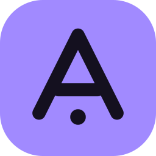
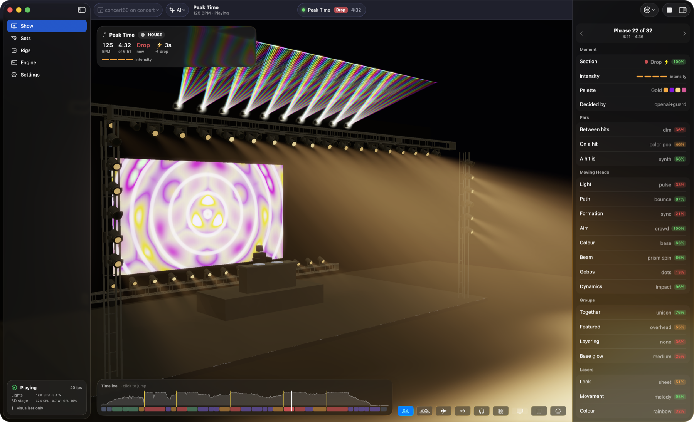
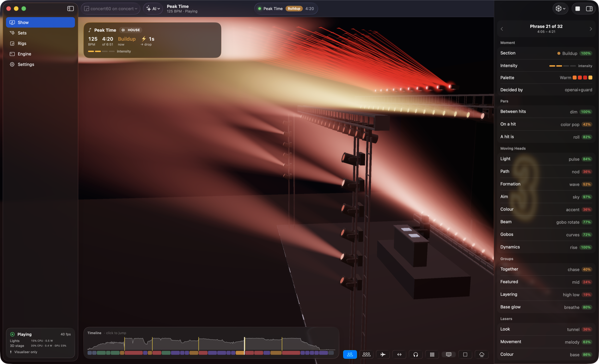
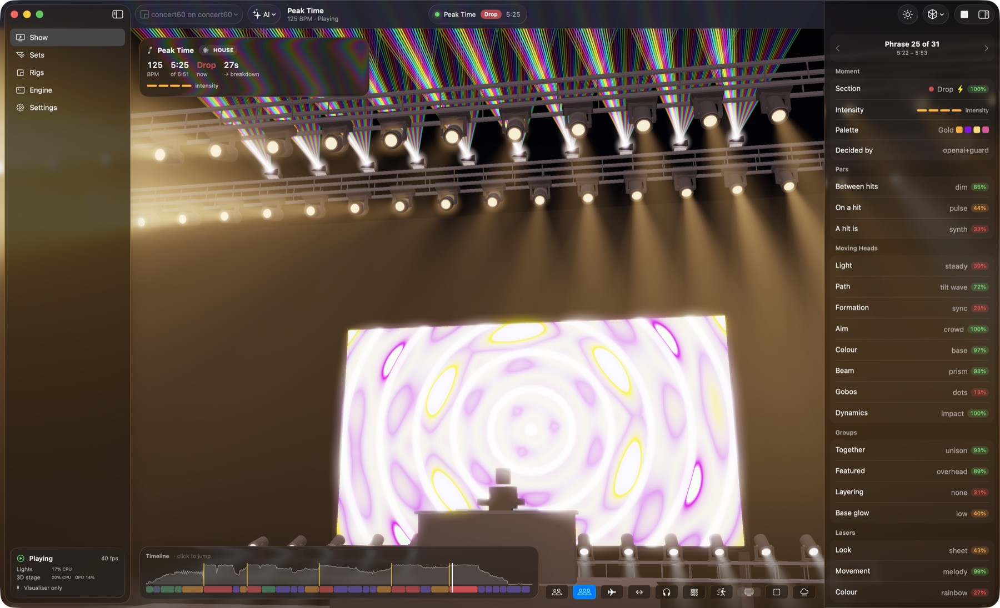
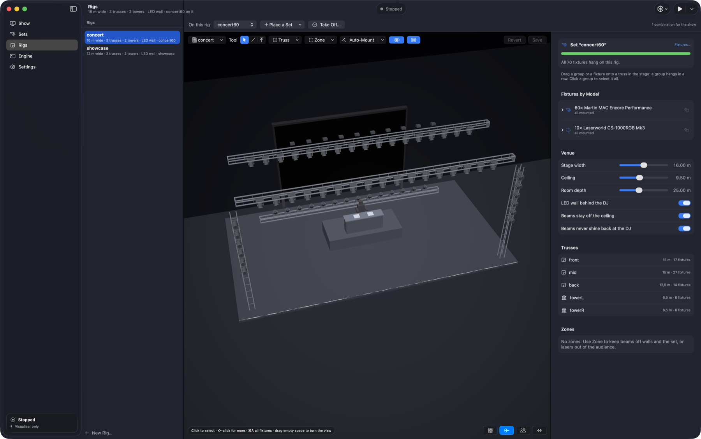

<div align="center">



# Amadeus DMX

### Your AI lighting director, the whole night long.

Amadeus DMX listens to the music you play and runs your lights like a lighting designer would:
from a gentle warm-up to the final party bangers, beat-exact, phrase by phrase.

[](https://github.com/mathijs-b2m/AmadeusDMX/releases/latest)
&nbsp;
[](https://github.com/mathijs-b2m/AmadeusDMX/releases/latest)
&nbsp;
[](docs/mac-setup.md)


<br><br>



<sub>The drop, live in the app: 60 moving heads, 10 lasers and an LED wall that counted it in. On the right, what the AI director chose for this phrase.</sub>

</div>

---

> [!IMPORTANT]
> ### 🎛️ Beta testers wanted
>
> **We need enthusiasts with real rigs to test our software and give feedback.** The 3D stage shows what
> Amadeus DMX *thinks* your lights do. Only real fixtures, real venues and real crowds show what they *actually* do.
>
> **You're the right tester if you have:**
> - **real DMX lights**: moving heads, pars, bars, strobes, lasers, smoke… any brand, any size of rig;
> - **a way to send DMX**: an Art-Net or sACN node, or a USB DMX interface;
> - **a Mac with Apple Silicon or a Windows PC** (Windows testers are especially welcome: it's brand new);
> - ideally **VirtualDJ, djay Pro or Mixxx**, and gigs or rehearsals to try it at: club nights, weddings,
>   parties, Latin nights, bands.
>
> **What we ask:** set up your rig in the app, run a show (a rehearsal in your living room counts), and tell us
> what you saw. Which fixtures worked straight away and which didn't, whether the lights hit the beat, whether
> the night felt right, and what confused you along the way. A short phone video says more than a page of text.
>
> **[Send a beta report →](https://github.com/mathijs-b2m/AmadeusDMX/issues/new?template=beta-report.yml)**
> &nbsp;·&nbsp; [How feedback works](#beta-testing-and-feedback)

---

> **A note from the maker**
>
> I created Amadeus DMX because it's the software I always missed in my career as a mobile DJ. There is
> nothing like it on the (free) market: a fully AI-powered lighting director that assists you the entire
> evening of a gig. From the easy build-up to the final party bangers, the show evolves with the night and
> the music.
>
> Setting up your rigs and fixtures has never been this easy. And afterwards? Press play!
>
> Oh, and: integrations for **djay Pro**, **VirtualDJ** and **Mixxx**, and even **Spotify** as a music source.
> For the power users: run Amadeus DMX on a separate lighting laptop. And now on **Mac and Windows**.
>
> — Mathijs

---

## Why DJs love it

<table>
<tr>
<td width="50%" valign="top">
<h3>🧠 An AI director for the whole night</h3>
<p>It decides the look for every musical phrase: which lights play, the colours, how the moving heads move. Use OpenAI, a free local model, or the rule-based director that works fully offline.</p>
</td>
<td width="50%" valign="top">
<h3>🌙 A night with a story</h3>
<p>The <b>show arc</b> follows your night from the music: a cosy warm-up while the room fills, building the floor, peaks, breathers, the finale. The big guns stay in the box until the moments that earn them. One hour or ten, club night, wedding, party or Latin night, in whatever order <i>you</i> play it.</p>
</td>
</tr>
<tr>
<td valign="top">
<h3>⚡ Exact to the beat</h3>
<p>Every track is analysed ahead of time: beats, bars, phrases, build-ups, drops, snare rolls. The kick leads, the drop lands with a hard cut and a flash, and the moving heads' moves land on the beat, because they come from the music itself, not from a guess.</p>
</td>
<td valign="top">
<h3>🎶 It hears the music, not just the beat</h3>
<p>Every genre gets its own house style: techno in ice and fire, reggaeton's boom-tac, a mirror ball for disco, rock lit like a drum kit with the guitar's strums, film scores played hit by hit like an orchestra. Pop songs get verses and choruses, not fake EDM drops.</p>
</td>
</tr>
<tr>
<td valign="top">
<h3>🛠️ Set up in minutes</h3>
<p>A set-up assistant walks you through your fixtures, the venue and where everything hangs. Drag fixtures onto straight or round trusses in the 3D rig editor, or let it hang them for you. About <b>2,400 fixtures from 200+ brands</b> are built in, offline. Something unusual? Map its channels by hand with the <b>DMX mapper</b>, trying them on the real light.</p>
</td>
<td valign="top">
<h3>📋 From the app to the truss</h3>
<p>Designed it in the app? Print a <b>hang sheet</b> for the crew: a plot from above, where every fixture goes, its DMX address and labels for the cases. After hanging, the <b>check</b> lights them one by one, and a swapped or turned fixture is put right in the app with one click.</p>
</td>
</tr>
<tr>
<td valign="top">
<h3>🎧 Plays along with your DJ software</h3>
<p>Follows your mix live in <b>VirtualDJ</b>, <b>djay Pro</b> and <b>Mixxx</b>: which deck plays, the crossfades, the drops. Even <b>Spotify</b> tracks in djay Pro and VirtualDJ can light up (opt-in). A track loaded at the last second plays a groove on its tempo until its own show is ready.</p>
</td>
<td valign="top">
<h3>💻 A lighting laptop, if you want one</h3>
<p>Keep your DJ laptop for the music. <b>Amadeus Link</b> on the DJ laptop pairs with the lighting computer through a 4-digit code, and the show follows your mix over the network. Mac and Windows, in any combination.</p>
</td>
</tr>
<tr>
<td valign="top">
<h3>🎛️ Live knobs</h3>
<p>Take over at any moment: how many lights play, special effects, the LED wall, smoke, movement, colour variety, drop size, flashes, intensity. Give a knob back and the show arc takes over again. Smoke machines are played too, sized to the machine and the room.</p>
</td>
<td valign="top">
<h3>🛡️ Safe by default</h3>
<p>Flashes are capped at 3 Hz, nothing strobes along with the music, and laser zones, keep-out zones and eye-safety rules keep beams where they belong. While you set up, a brightness limiter caps every light (and tells you it's on).</p>
</td>
</tr>
</table>

**See it before you rig it:** a live 3D stage shows every beam, so you can plan and try a show without a
single light connected, and fly through the room for any point of view. When you're ready, the same show goes
out over Art-Net, sACN or a USB DMX interface.

<table>
<tr>
<td width="50%" valign="top">

<p align="center"><sub>The build-up: the LED wall counts down to the drop</sub></p>
</td>
<td width="50%" valign="top">

<p align="center"><sub>The same drop from the dance floor</sub></p>
</td>
</tr>
<tr>
<td colspan="2" valign="top">

<p align="center"><sub>The rig editor: your venue, with every fixture where it hangs</sub></p>
</td>
</tr>
</table>

## Get started

> [!TIP]
> **Switch everything on.** The **[Mac setup guide](docs/mac-setup.md)** walks you through every step with
> screenshots: the AI director's OpenAI key, the instrument analysis models, lighting Spotify tracks, your DJ
> software, your rig and your lights. Fifteen minutes that make the difference.

1. **[Download Amadeus DMX](https://github.com/mathijs-b2m/AmadeusDMX/releases/latest)** from the latest release.
   - **Mac** (Apple Silicon, macOS 26 or later): open the disk image and drag the app to Applications. It's
     signed and notarized by Apple, so it opens like any other app.
   - **Windows** (Windows 10 22H2 or 11, x64): run the installer. Until our Windows certificate is in place,
     SmartScreen may say *Windows protected your PC*: click *More info* › *Run anyway*. You only do this once.
2. **Switch on the extras** in Settings: your OpenAI key for the AI director, the optional packs
   (instrument analysis and streamed tracks) and *Light streamed tracks*. See the
   [setup guide](docs/mac-setup.md).
3. **Follow the set-up assistant:** your fixtures, your venue, done. No lights yet? Start with one of the
   example rigs and watch the 3D stage.
4. **Press play.** Play a track, or start a live show and DJ as usual.

Using a separate lighting laptop? Put **Amadeus Link** (on the same download page) on the DJ laptop.

Updates install themselves when you allow them, never in the middle of a show.

### System requirements

| | Mac | Windows |
|---|---|---|
| **Minimum** | Apple Silicon (M1 or later), macOS 26, 8 GB memory | x64, 4 cores, Windows 10 22H2 or 11, 8 GB memory, DirectX 10 graphics |
| **Recommended** | M1 Pro / M2 or later, 16 GB memory, wired Ethernet to the DMX node | 6+ cores, 16 GB memory, an NVIDIA GeForce GTX 16 / RTX 20 or newer, wired Ethernet to the DMX node |
| **Big rigs** (50+ heads, lasers, in 3D) | a Pro or Max chip | a recent NVIDIA card |

You'll also need:
- **a way to send DMX**: an Art-Net or sACN node, or a USB DMX interface;
- **any DMX fixtures**: about 2,400 are built in, and others can be mapped by hand;
- **optionally**, VirtualDJ, djay Pro or Mixxx, and an OpenAI key for the AI director (or a free local
  model with Ollama).

What each part uses, measured, and the details per system: [system requirements](docs/system-requirements.md).

## Beta testing and feedback

Amadeus DMX is in **beta**: it runs real shows, but every rig is different, and we can only test on the rigs
we have. All feedback goes through **GitHub Issues**, in the open, so other testers can add to a report
instead of writing the same one again. You need a free GitHub account.

1. **Look first.** [Search the open issues](https://github.com/mathijs-b2m/AmadeusDMX/issues): if your fixture,
   DJ software or problem is already there, give it a 👍 and add your own details.
2. **Open an issue** with one of the forms:
   - **[🎛️ Beta report](https://github.com/mathijs-b2m/AmadeusDMX/issues/new?template=beta-report.yml)**:
     you ran a show (or a rehearsal) on a real rig. What you have, what worked, what didn't, how it felt.
   - **[🐞 Bug report](https://github.com/mathijs-b2m/AmadeusDMX/issues/new?template=bug-report.yml)**: something
     is broken: a crash, a fixture doing the wrong thing, lights out of sync.
   - **[💡 Idea](https://github.com/mathijs-b2m/AmadeusDMX/issues/new?template=idea.yml)**: something you'd love
     the software to do.
3. **Attach what helps us see it.** A short phone video of the lights with the music audible is gold. Add the
   app's version (Settings › General), your fixtures and DMX interface, and when it matters the files from your
   data folder: your set and rig (`config/sets/`, `config/rigs/`) and the live show's log (`.cache/live.log`).
   The data folder is `~/Library/Application Support/Amadeus DMX` on a Mac and `%LOCALAPPDATA%\Amadeus DMX` on
   Windows. Drag the files into the issue.
4. **We reply on the issue**, label it (`fixture`, `sync`, `windows`, `safety`, …) and may ask you to try
   something. Fixes ship in the next release and the app updates itself; when it's fixed, we close the issue
   with the version that has it.

**Anything that could hurt someone** (a strobe faster than it should be, a laser beam where it shouldn't be)
gets the highest priority: start the title with **Safety**. Questions that aren't a bug or an idea are welcome
as an issue too.

---

## For developers

Everything below is for people who want to build Amadeus DMX themselves, look under the hood or contribute.
To use the software, the [installers](https://github.com/mathijs-b2m/AmadeusDMX/releases/latest) are all you need.

### How it works

Tracks are analysed (beats, bars, phrases, drops, build-ups, snare rolls, synth stutters and riffs, the
song's form), a **decision model** designs a layered light show per musical phrase, the **show arc** shapes the
whole night, and a real-time engine drives moving heads, pars, bars, strobes, lasers and smoke at 40 frames a
second, beat-locked.

```
                      ┌─────────────── per track, ahead of time ───────────────┐
 audio (WAV/MP3/M4A) ─► analysis ─────────► director ─────────────► plan per phrase
                        beats, bars,         decision model picks     section + palette +
                        phrases, drops,      section, palette and     look layers
                        rolls, form, riffs   look layers (+ safety nets)
                      └────────────────────────────────────────────────────────┘
 position in the track ─► engine (40 fps) ─► show arc ─────► DMX ─► node / USB ─► fixtures
 (audio clock, VirtualDJ,   kick-led light,    the night's      └► 3D stage (Mac, Windows, browser)
  djay, Mixxx, Amadeus Link) beat-landed moves  stage + knobs
```

**The AI chooses the look; it never triggers individual hits.** Choices are made once per phrase (4–16 bars).
Everything time-critical (the kick, flashes, beat-locked head moves, the drop hit, snare rolls) comes from the
analysis, so it's exact to the beat.

The engine is Python (`amadeus/`). The apps are native front ends that start it and read its feed: Swift and
Metal on the Mac (`mac/`), C#, WinUI 3 and Direct3D 11 on Windows (`windows/`). There is also a browser
visualiser and setup page (`web/`).

### Build from source

```bash
python3 -m venv .venv
.venv/bin/pip install -e ".[openai]"         # add ",ml" for instrument separation, ",usb" for USB DMX
.venv/bin/amadeus play "track.mp3"           # the 3D visualiser: http://localhost:8080
.venv/bin/amadeus play "track.mp3" --dmx     # … and the real lights
```

- **Mac app:** `cd mac && ./build-app.sh --install` ([mac/README.md](mac/README.md)).
- **Windows app:** `cd windows && ./build.ps1` ([windows/README.md](windows/README.md)).
- **VirtualDJ plugin:** `./vdj/build.sh --install` (Mac) or `vdj\build.ps1` (Windows).

### Documentation

| | |
|---|---|
| [Mac setup guide](docs/mac-setup.md) | Installing and switching on every feature, step by step with screenshots |
| [System requirements](docs/system-requirements.md) | Minimum and recommended hardware for Mac and Windows, and what each part uses |
| [How it works](docs/how-it-works.md) | The analysis, the director and decision models, genres and house styles, the show arc, the engine |
| [Command line](docs/command-line.md) | Every `amadeus` command, VirtualDJ live mode, the sync test, sets and rigs, the hardware checklist |
| [Architecture](docs/architecture.md) | The code map: which package does what, and which way the dependencies go |
| [Sets and rigs](docs/rig-format.md) | The file formats, trusses, auto-mount, the hang sheet |
| [Your own AI assistant](docs/ai-assistants.md) | Claude Desktop, Claude Code or Codex sets up your sets and rigs (`amadeus mcp`) |
| [DJ software](docs/dj-software.md) | Each integration: what it reads, what it needs, what it's tested on |
| [Protocols](docs/protocols.md) | The engine's feed, the VirtualDJ plugin, Amadeus Link |
| [Fixture catalogue](docs/fixture-catalog.md) · [Fixture twin](docs/fixture-twin.md) | QLC+ / OFL conversion; checking head motion against the real fixture |
| [Safety](docs/safety.md) | Flash limits, strobe-free, eye safety, zones and the laser guard |

### Project layout

| Path | What's there |
|---|---|
| `amadeus/` | The engine (Python): `audio/`, `director/`, `engine/`, `show/`, `rig/`, `library/`, `dmx/`, `setup/`, `web/`, `cli/` |
| `mac/` | The Mac app and Amadeus Link for Mac |
| `windows/` | The Windows app and Amadeus Link for Windows |
| `web/` | Browser UI: 3D visualiser, setup page, mobile rig setup |
| `vdj/` | The AmadeusLink VirtualDJ plugin |
| `mixxx/` | The Mixxx controller mapping |
| `fixtures/` | The fixture library, and every QLC+ / OFL fixture already converted |
| `examples/` | Example sets and rigs; your own go to `config/` (not in git) |
| `tests/` | Golden-master and unit tests |

### Contributing and license

Contributions are welcome: see [CONTRIBUTING.md](CONTRIBUTING.md). Amadeus DMX is MIT licensed
([LICENSE](LICENSE)); fixture definitions converted from QLC+ are Apache-2.0 and the optional instrument models
are non-commercial, see [THIRD_PARTY_NOTICES.md](THIRD_PARTY_NOTICES.md).

Lighting can hurt people: strobes and flashes can trigger seizures, and lasers can blind. The safety
features here are aids, not guarantees; you are responsible for your rig and your audience.
