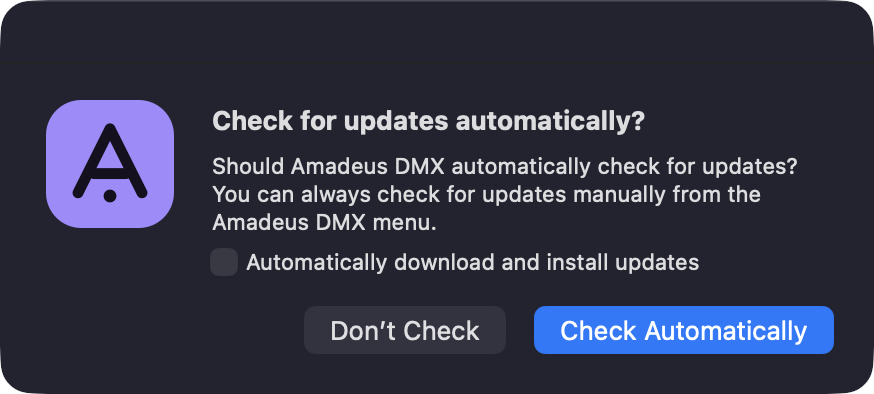
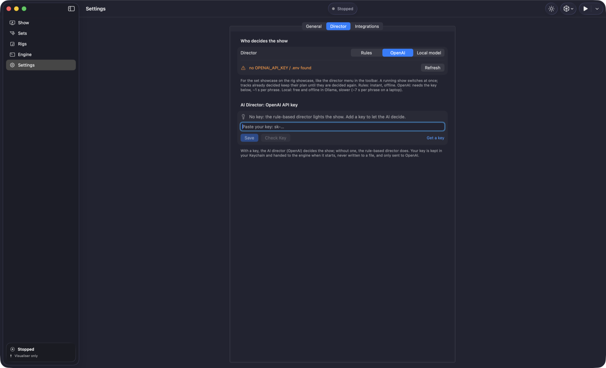
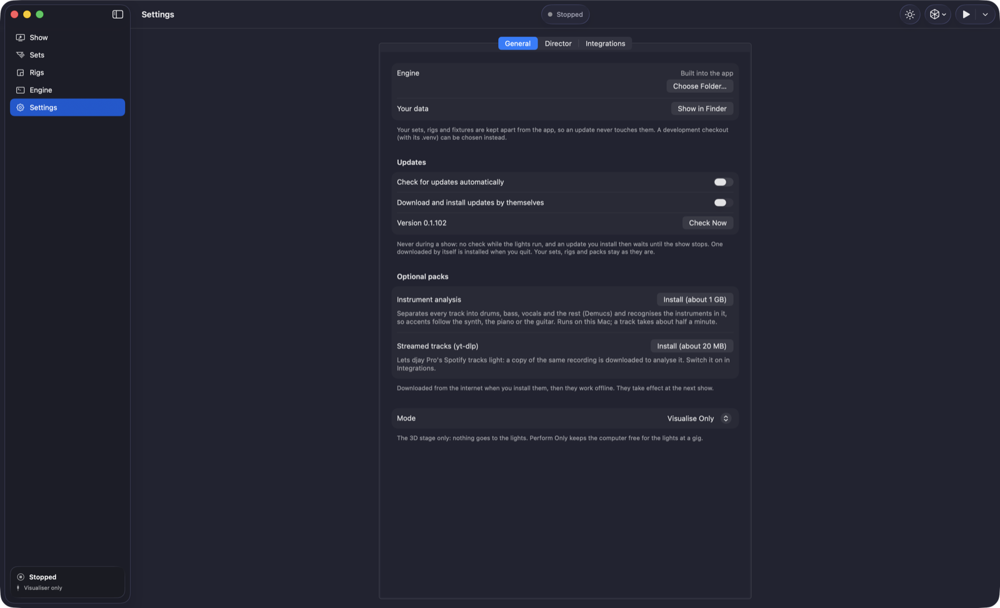
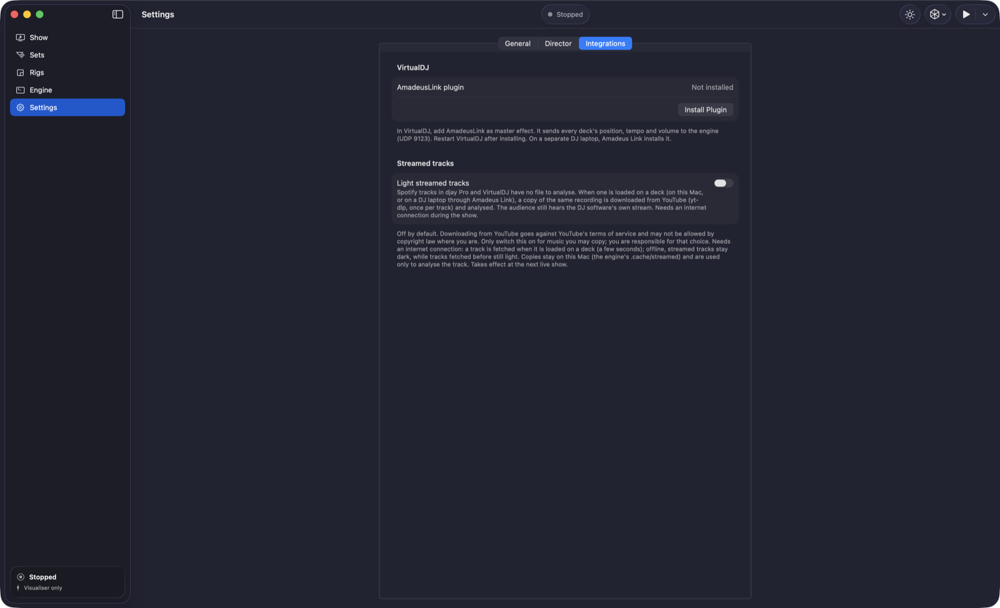
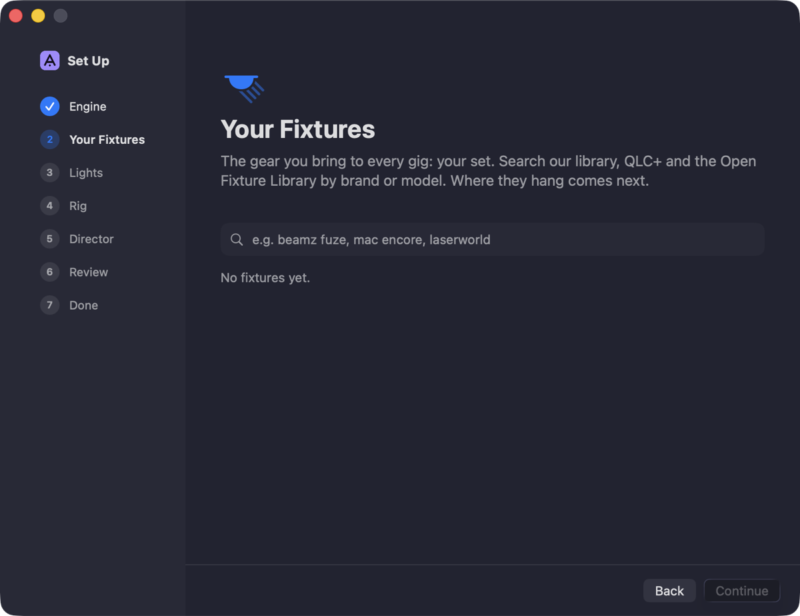
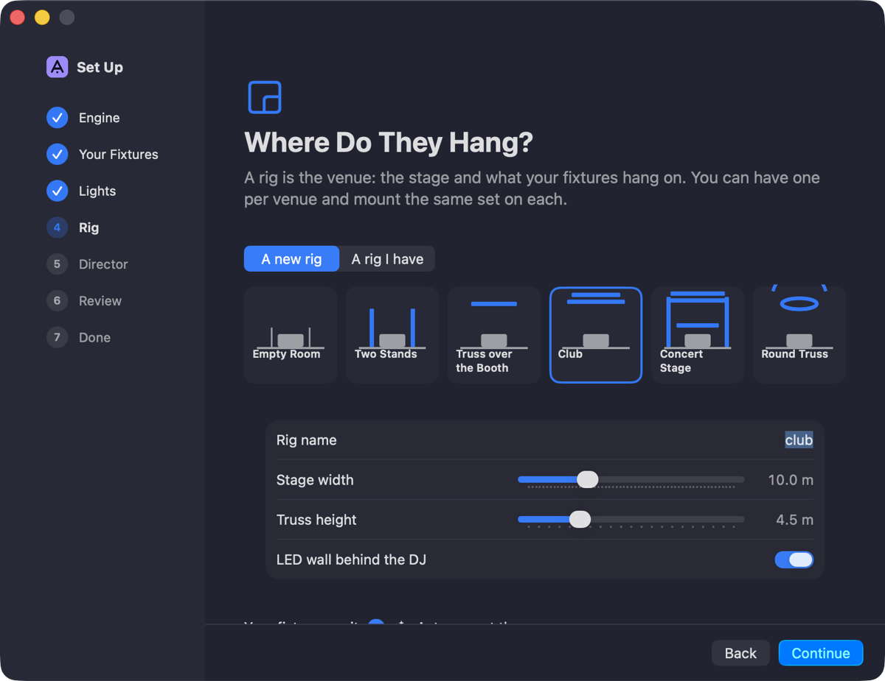
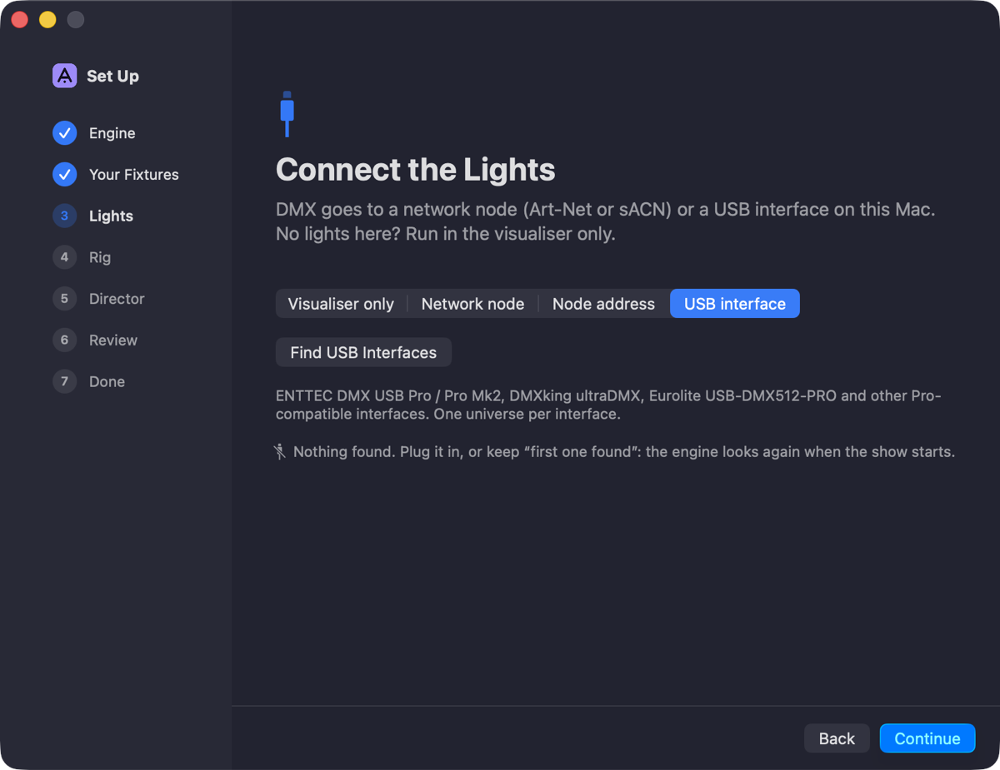
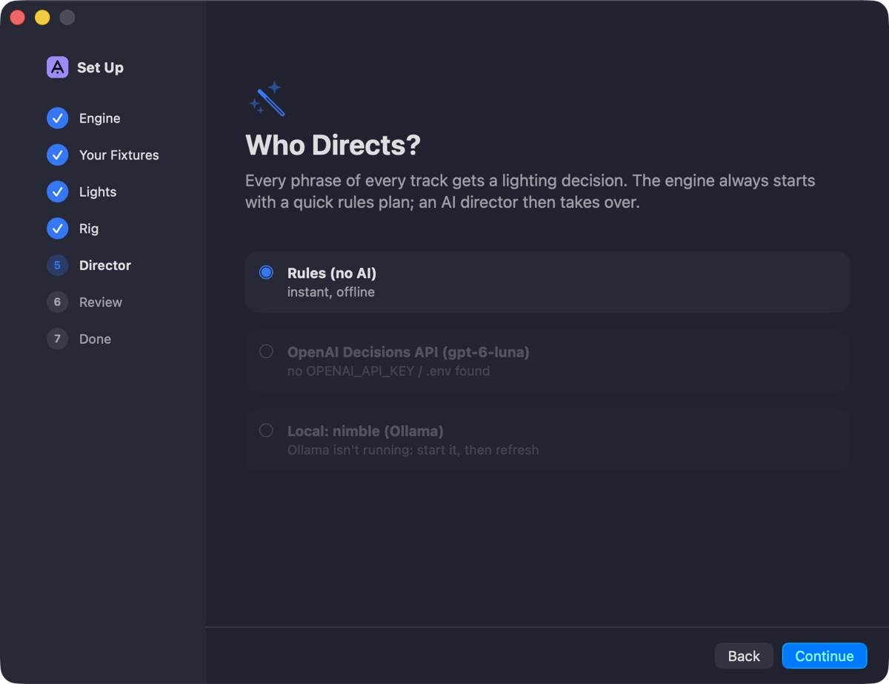
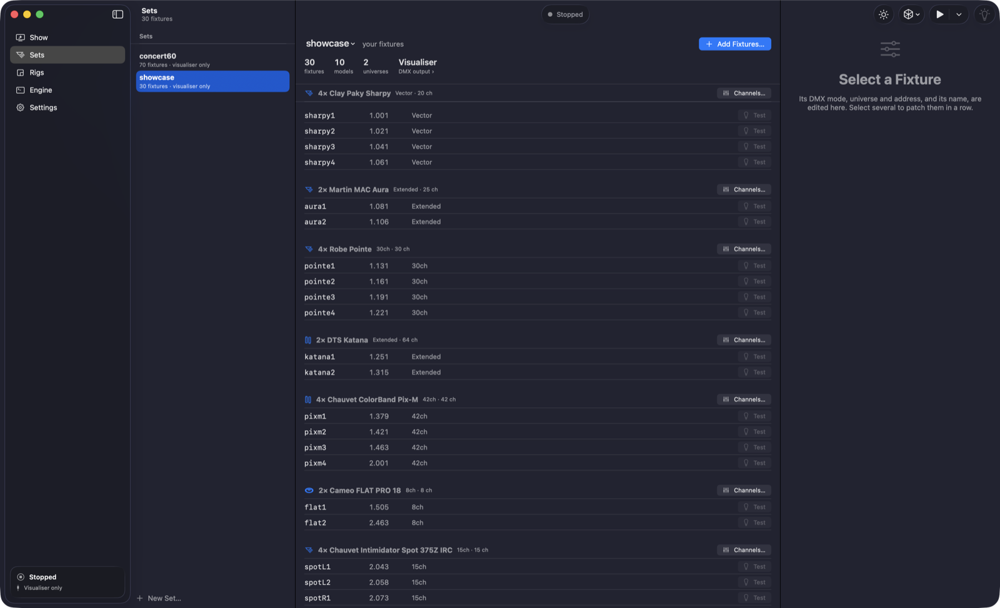
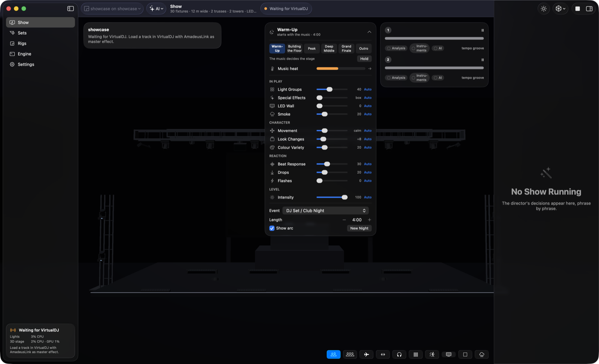

# Setting up Amadeus DMX on your Mac

Everything from the download to your first show, **with every feature switched on**. Most of it is one-time
work of about 15 minutes, plus the downloads. Out of the box Amadeus DMX already plays a good show. The steps
marked ⭐ are what turns it into the full experience, so please don't skip them.

| | Step | What you get | Time |
|---|---|---|---|
| 1 | [Install the app](#1-install-the-app) | | 2 min |
| 2 | [Turn on updates](#2-turn-on-updates) | New features and fixes by themselves | 1 min |
| 3 | ⭐ [Add your OpenAI key](#3--add-your-openai-key-the-ai-director) | The AI director instead of the rule-based one | 5 min |
| 4 | ⭐ [Install the optional packs](#4--install-the-optional-packs) | Instrument analysis (the two extra models) and streamed tracks | 5–15 min, mostly downloading |
| 5 | ⭐ [Light Spotify tracks](#5--light-spotify-tracks) | Spotify tracks in djay Pro and VirtualDJ light up too | 1 min |
| 6 | [Connect your DJ software](#6-connect-your-dj-software) | The lights follow your mix live | 2–5 min |
| 7 | [Set up your rig](#7-set-up-your-rig-with-the-assistant) | Your fixtures and your venue | 5–10 min |
| 8 | [Connect the lights](#8-connect-the-lights) | DMX to the real fixtures | 5 min |
| 9 | [Run the night](#9-run-the-night-the-show-arc) | The show arc and its live knobs | |

You'll need a Mac with **Apple Silicon** and **macOS 26** or later (16 GB of memory recommended with instrument
analysis; see the [system requirements](system-requirements.md)), and an internet connection for steps 1–5.

---

## 1. Install the app

1. Go to the **[latest release](https://github.com/mathijs-b2m/AmadeusDMX/releases/latest)** and download
   **AmadeusDMX.dmg** (and **AmadeusLink.dmg** if you DJ on a different laptop, see step 6).
2. Open the disk image and drag **Amadeus DMX** to **Applications**.
3. Open it from Applications. It's signed and notarized by Apple, so it opens like any other app.

The first time it opens, it fills your library with two example rigs (a club and a concert stage), so you can
press play straight away and watch the 3D stage, even with no lights connected.

## 2. Turn on updates

On first launch the app asks whether to check for updates. Tick **Automatically download and install
updates** and click **Check Automatically**.

Updates never happen during a show: no check while the lights run, and an update waits until the show stops.
You can change this any time in **Settings › General › Updates** (both switches on).

## 3. ⭐ Add your OpenAI key (the AI director)

The **director** decides the look of every musical phrase. Without a key the rule-based director does that
(instant and offline, but it repeats itself). With an OpenAI key the **AI director** takes over: it reads
each phrase, knows the song's arc, and picks lights, colours and moves like a lighting designer.

1. Get a key at **[platform.openai.com/api-keys](https://platform.openai.com/api-keys)** (log in, *Create new
   secret key*, copy it). The API is paid per use, separately from a ChatGPT subscription: add a little
   credit under *Billing*. A track takes one call per phrase.
2. In Amadeus DMX open **Settings › Director**.
3. Paste the key in the field under **AI Director: OpenAI API key**, click **Save**, then **Check Key**.
4. Under **Who decides the show**, choose **OpenAI**.

Your key is kept in your Mac's **Keychain**. It's handed to the engine when a show starts, never written to a
file, and only sent to OpenAI. The toolbar on the Show page then says **✨ AI**.

> **Rather stay offline?** Choose **Local model**: a free AI director that runs on your own Mac with
> [Ollama](https://ollama.com). Install Ollama, run `ollama pull nimble` in Terminal, and click **Refresh**.
> It's slower (about 7 seconds per phrase on a laptop); in a live show the rule-based plan plays until it's ready.

## 4. ⭐ Install the optional packs

Two packs are left out of the download to keep it small. Install both: **Settings › General › Optional
packs** › **Install** next to each one.

- **Instrument analysis** (about 1 GB) brings the **two extra models**:
  - **instrument separation** (Demucs) splits every track into drums, bass, vocals and the rest;
  - **instrument recognition** (the MTG-Jamendo models) names what plays: synth, piano, guitar, strings, voice…

  With them, the accents follow the instrument that leads (the piano in a piano intro, the guitar in a
  rock song), rock and metal play the **drum kit** (kick and snare, the snare ringing out with its reverb),
  songs get proper **verses and choruses**, and **disco** is recognised by its sound. A track takes about half
  a minute extra to prepare, on your Mac. The recognition models are free for **non-commercial use**.
- **Streamed tracks** (about 20 MB) is what step 5 needs.

They download once and then work offline. They take effect at the next show.

## 5. ⭐ Light Spotify tracks

Spotify tracks in **djay Pro** and **VirtualDJ** have no file the app can analyse. With this switched on,
when you load one on a deck, Amadeus DMX fetches a copy of the same recording, analyses it in a few seconds,
and lights it like any other track. Your audience still hears the DJ software's own stream.

1. Install the **Streamed tracks** pack (step 4).
2. Open **Settings › Integrations** and switch on **Light streamed tracks**. Read the note and click
   **Switch On**.

It needs an internet connection during the show. Only use it for music you may copy: the copy comes from
YouTube, which goes against YouTube's terms of service and may not be allowed where you live. Copies stay on
your Mac and are only used to analyse the track.

## 6. Connect your DJ software

The show follows your mix live: which deck plays, where in the track, the crossfades, the drops. Start it
from the **▶ Start** menu in the toolbar, **Start Live Show (…)** for your DJ software.

**VirtualDJ**
1. **Settings › Integrations › VirtualDJ › Install Plugin** (see the screenshot above).
2. Restart VirtualDJ. In its effects, add **AmadeusLink** as a **master** effect.
3. **Start › Start Live Show (VirtualDJ)**.

**djay Pro**
1. **Start › Start Live Show (djay Pro)**.
2. macOS asks whether Amadeus DMX may use **Accessibility**: allow it in **System Settings › Privacy &
   Security › Accessibility**. The app only *reads* djay's deck labels with it. It never clicks or types.
3. Turn on **SYNC** in djay for the tightest timing.

**Mixxx**
1. **Start › Start Live Show (Mixxx)** first, then start Mixxx (it only looks for controllers when it starts).
2. In Mixxx: **Preferences › Controllers › Amadeus DMX**, load the mapping **Amadeus DMX**, tick **Enabled**.

**DJ on another laptop?** Install **Amadeus Link** on the DJ laptop. It shows a 4-digit code (and installs the
VirtualDJ plugin there itself). On the lighting Mac choose **Start › Start with a DJ Laptop…** and enter the
code. Amadeus Link reads VirtualDJ, djay Pro and Mixxx, Spotify tracks included.

No DJ software? Press ⌘O and play a track from your Mac.

## 7. Set up your rig with the assistant

**File › New Set…** opens the set-up assistant. It makes your **set** (the fixtures you own) and a **rig**
(the venue they hang in), and mounts one on the other. On the Sets page your own sets are listed under **Your
Sets**, the two you started with under **Examples**: put your fixtures in a set of your own, not in an example.

<table>
<tr>
<td width="50%"></td>
<td width="50%"></td>
</tr>
<tr>
<td><b>Your Fixtures:</b> search about 2,400 fixtures by brand or model, offline, and pick the DMX mode set on the fixture.</td>
<td><b>Where Do They Hang:</b> pick a venue (empty room, stands, a truss over the booth, club, concert stage, round truss) and its size.</td>
</tr>
<tr>
<td></td>
<td></td>
</tr>
<tr>
<td><b>Connect the Lights:</b> an Art-Net or sACN node on your network, a USB DMX interface, or the visualiser only for now.</td>
<td><b>Who Directs:</b> choose <b>OpenAI</b>. It's only available once your key is in (step 3).</td>
</tr>
</table>

Then **Create and Mount**: the assistant hangs every fixture the way a lighting tech would. Fine-tune it on
the **Rigs** page: drag fixtures onto trusses, add round trusses, draw zones that keep beams off walls and
lasers out of the audience, and switch **Outdoor** on for an open-air stage.

Hanging it for real? The printer button in the rig editor prints a **hang sheet** for the crew. After
hanging, the checklist button lights the fixtures one by one, so a swapped or turned fixture is fixed with
one click.

## 8. Connect the lights

1. **Show › DMX Devices & Output…** (⇧⌘D): click **Search** to find your Art-Net or sACN node, or **Add** a node
   or a USB interface. Then pick, per universe of your set, which device and output it goes to.
2. On the **Sets** page every fixture has a **Test** button: it lights that one fixture so you can check its
   address and mode. A fixture the show can't drive from its library file is marked there; **Channels…** opens
   the **DMX mapper** to map it by hand while you watch the light.
3. Set **Settings › General › Mode** to **Perform + Visualise** (or **Perform Only** at a gig, to keep the
   Mac's graphics free for the lights). In **Visualise Only** nothing goes to the lights.

While you set up, the **☀︎ brightness limiter** in the toolbar caps every light, so testing doesn't blind you.
A striped banner shows whenever it's on. It starts at 100 % each time the app opens; set it back to
100 % for the show.

## 9. Run the night: the show arc

Start a live show and open the **night card** at the top of the stage. The **show arc** reads your night from
the music: warm-up, building the floor, peak, deep middle, grand finale, outro, in whatever order you play
them. The big effects stay in the box until the moments that earn them.

- Set the **Event** (DJ set / club night, wedding, party, Latin night) and the night's **Length**. One hour or
  ten, it scales.
- Every knob is on **Auto**. Drag one to take it over, and click **Auto** to give it back to the arc.
- Click a stage to force it, or **Hold** to stay in it. **New Night** starts the arc over.

That's it: press play and enjoy the show. Something not working, or looking wrong on your lights? Please
[send a beta report](https://github.com/mathijs-b2m/AmadeusDMX/issues/new?template=beta-report.yml). That's
how Amadeus DMX gets better on every rig.
